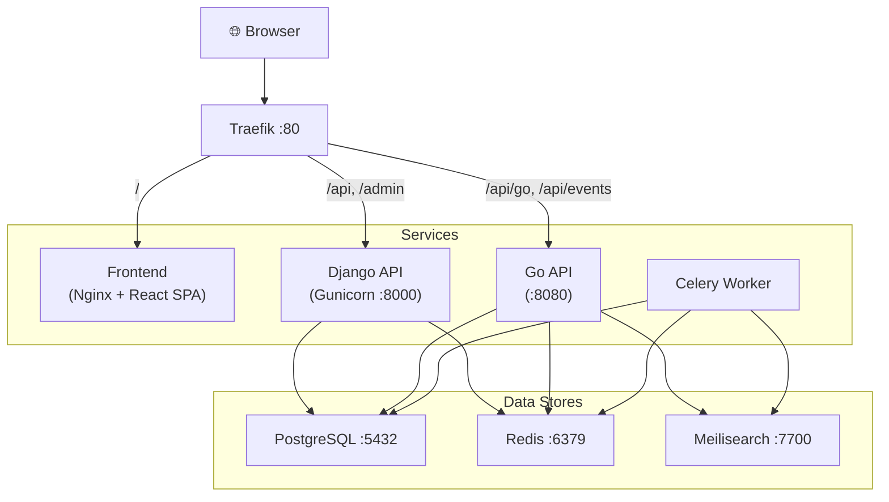

# 🐳 Docker Deployment Guide

Deploy TMS anywhere using pre-built Docker images — **no source code required**.

---

## Prerequisites

| Requirement | Minimum |
| :--- | :--- |
| Docker Engine | 24+ |
| Docker Compose | V2 (included with Docker Desktop) |
| RAM | 2 GB |
| Disk | 10 GB |

---

## Quick Start

### 1. Download the compose file and environment template

Choose the commands for your operating system to set up your directory and download the configuration files:

#### Linux & macOS (Bash/Zsh)

```bash
# Create and enter the directory
mkdir tms && cd tms

# Download configuration files
curl -LO https://raw.githubusercontent.com/sauryah/TMS/main/docker-compose.ghcr.yml
curl -LO https://raw.githubusercontent.com/sauryah/TMS/main/.env.example

# Create the environment file
cp .env.example .env
```

#### Windows (PowerShell)

```powershell
# Create and enter the directory
New-Item -ItemType Directory -Path tms
Set-Location tms

# Download configuration files
Invoke-WebRequest -Uri "https://raw.githubusercontent.com/sauryah/TMS/main/docker-compose.ghcr.yml" -OutFile "docker-compose.ghcr.yml"
Invoke-WebRequest -Uri "https://raw.githubusercontent.com/sauryah/TMS/main/.env.example" -OutFile ".env.example"

# Create the environment file
Copy-Item .env.example .env
```

#### Windows (Command Prompt / cmd.exe)

```cmd
:: Create and enter the directory
mkdir tms && cd tms

:: Download configuration files
curl -LO https://raw.githubusercontent.com/sauryah/TMS/main/docker-compose.ghcr.yml
curl -LO https://raw.githubusercontent.com/sauryah/TMS/main/.env.example

:: Create the environment file
copy .env.example .env
```

---

### 2. Configure your environment

Open the generated `.env` file in your favorite text editor (e.g., VS Code, Notepad, Vim) and customize the keys.

> [!CAUTION]
> **You MUST change these values before running in production:**
>
> * `POSTGRES_PASSWORD` — Use a strong, random password.
> * `ROOT_PASSWORD` — Initial admin panel password.
> * `REDIS_PASSWORD` — Password for Redis; must match across `docker-compose.yml` and all `CELERY_*` URLs.
> * `INTERNAL_API_SECRET` — Shared secret for Django ↔ Go API communication.
> * `DJANGO_SECRET_KEY` — Generate a secure key:
>   * **Cross-platform (Python):** `python -c "import secrets; print(secrets.token_urlsafe(64))"`
> * `MEILI_MASTER_KEY` — Generate a secure key:
>   * **Linux/macOS:** `openssl rand -base64 32`
>   * **Windows (PowerShell):** `[Convert]::ToBase64String((1..32 | ForEach-Object { Get-Random -Minimum 0 -Maximum 256 } -As Byte))`

---

### 3. Start the application

Run this command from inside your `tms` directory:

```bash
docker compose -f docker-compose.ghcr.yml up -d
```

The application will be available at **[http://localhost](http://localhost)** once all services are healthy (usually ~30 seconds).

---

## Architecture



---

## Available Images

| Component | Docker Hub | GHCR | Description |
| :--- | :--- | :--- | :--- |
| Backend | `sauryah/tms-backend` | `ghcr.io/sauryah/tms/backend` | Django API + Celery worker |
| Frontend | `sauryah/tms-frontend` | `ghcr.io/sauryah/tms/frontend` | React SPA served via Nginx |
| Go API | `sauryah/tms-go-api` | `ghcr.io/sauryah/tms/go-api` | High-performance search & SSE |

All images are built for **linux/amd64** and **linux/arm64**.

---

## Configuration Reference

| Variable | Default | Description |
| :--- | :--- | :--- |
| `POSTGRES_DB` | `tms` | Database name |
| `POSTGRES_USER` | `tms_user` | Database username |
| `POSTGRES_PASSWORD` | *(change me)* | Database password |
| `REDIS_PASSWORD` | `change_me_redis_password` | Redis password; must match across `docker-compose.yml`, `CELERY_BROKER_URL`, and `CELERY_RESULT_BACKEND` |
| `DJANGO_SECRET_KEY` | *(change me)* | Django cryptographic signing key |
| `DJANGO_DEBUG` | `False` | Enable debug mode (never `True` in production) |
| `DJANGO_ALLOWED_HOSTS` | `localhost` | Comma-separated list of allowed hostnames |
| `INTERNAL_API_SECRET` | *(change me)* | Shared secret for Django ↔ Go API communication |
| `CELERY_BROKER_URL` | `redis://:change_me_redis_password@redis:6379/0` | Redis URL for Celery message broker |
| `CELERY_RESULT_BACKEND` | `redis://:change_me_redis_password@redis:6379/0` | Redis URL for Celery task results |
| `MEILI_MASTER_KEY` | *(change me)* | Meilisearch authentication key |
| `MEILI_SEARCH_KEY` | *(empty)* | Optional read-only Meilisearch key |
| `ROOT_USERNAME` | `root` | Initial admin username |
| `ROOT_PASSWORD` | *(change me)* | Initial admin password |
| `SESSION_IDLE_TIMEOUT_MINUTES` | `30` | Session idle timeout |
| `SESSION_ABSOLUTE_TIMEOUT_HOURS` | `12` | Maximum session lifetime |
| `HISTORY_RETENTION_DAYS` | `365` | How long to keep audit history |
| `TMS_VERSION` | `latest` | Image version tag to use |

---

## Pinning a Version

To deploy a specific release instead of `latest`:

```bash
# Via environment variable
TMS_VERSION=1.1.0 docker compose -f docker-compose.ghcr.yml up -d

# Or add to your .env file
echo "TMS_VERSION=1.1.0" >> .env
docker compose -f docker-compose.ghcr.yml up -d
```

---

## Updating

```bash
# Pull the latest images
docker compose -f docker-compose.ghcr.yml pull

# Recreate containers with new images (zero-downtime for stateless services)
docker compose -f docker-compose.ghcr.yml up -d

# Clean up old images
docker image prune -f
```

> [!TIP]
> Migrations run automatically on every startup via the `migrate` service.

---

## Backup & Recovery

### Automatic Backups

Celery Beat triggers database backups **daily at 2:00 AM** via the `auto_backup_task` (`python manage.py backup_db`), writing PostgreSQL custom-format archives to `/backups/`:

* Backups are stored as `tms_backup_YYYYMMDD_HHMMSS.dump` alongside MD5 checksum files (`.dump.md5`).
* Backups persist across container restarts in the `tms_backups` Docker volume.

### Manual Backup

```bash
# Trigger an immediate backup
docker compose -f docker-compose.ghcr.yml exec django python manage.py backup_db

# List existing backups
docker compose -f docker-compose.ghcr.yml exec django ls -lh /backups/
```

### Restore from Backup

```bash
# Restore directly using pg_restore inside the django container
docker compose -f docker-compose.ghcr.yml exec django pg_restore -h db -p 5432 -U tms_user -d tms --clean --if-exists /backups/tms_backup_YYYYMMDD_HHMMSS.dump

# After restore, synchronize the search index
docker compose -f docker-compose.ghcr.yml exec django python manage.py sync_search
```

---

## Troubleshooting

### Check service health

```bash
docker compose -f docker-compose.ghcr.yml ps
docker compose -f docker-compose.ghcr.yml logs --tail=50 django
```

### Port 80 already in use

```bash
# Find what's using port 80
# Linux/Mac:
sudo lsof -i :80
# Windows:
netstat -ano | findstr :80
```

Or change the Traefik port in the compose file:

```yaml
traefik:
  ports:
    - "8080:80"  # Access at http://localhost:8080 instead
```

### Health check failures

If services keep restarting, check the logs:

```bash
# Check all logs
docker compose -f docker-compose.ghcr.yml logs

# Check specific service
docker compose -f docker-compose.ghcr.yml logs django
docker compose -f docker-compose.ghcr.yml logs go-api

# Follow logs in real-time
docker compose -f docker-compose.ghcr.yml logs -f
```

### Database connection issues

Ensure the database is fully healthy before other services start:

```bash
docker compose -f docker-compose.ghcr.yml logs db
docker compose -f docker-compose.ghcr.yml exec db pg_isready -U tms_user -d tms
```

### Recover root password

If the root password is lost or compromised, reset it directly:

```bash
docker compose -f docker-compose.ghcr.yml exec -T django python manage.py changepassword root
# Enter new password when prompted
```

### Reset everything

```bash
# Stop all services and remove volumes (⚠️ deletes all data)
docker compose -f docker-compose.ghcr.yml down -v

# Start fresh
docker compose -f docker-compose.ghcr.yml up -d
```

---

## Using Docker Hub Images Instead

If you prefer Docker Hub over GHCR, replace the image references in the compose file:

```yaml
# Change from:
image: ghcr.io/sauryah/tms/backend:${TMS_VERSION:-latest}
# To:
image: sauryah/tms-backend:${TMS_VERSION:-latest}
```

| Service | GHCR (default) | Docker Hub |
| :--- | :--- | :--- |
| backend | `ghcr.io/sauryah/tms/backend` | `sauryah/tms-backend` |
| frontend | `ghcr.io/sauryah/tms/frontend` | `sauryah/tms-frontend` |
| go-api | `ghcr.io/sauryah/tms/go-api` | `sauryah/tms-go-api` |
