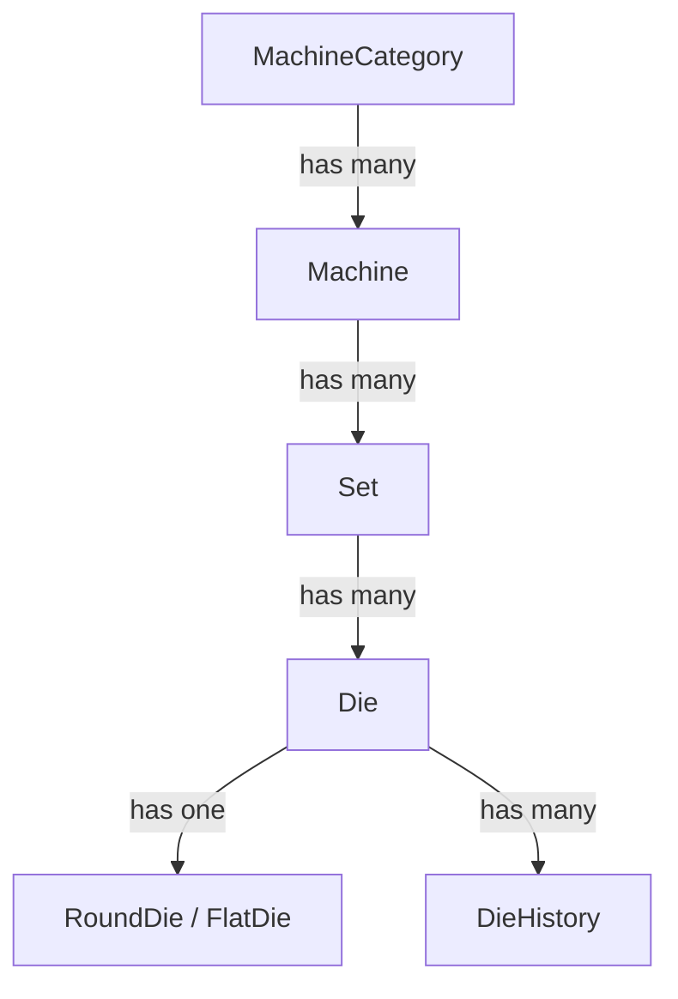
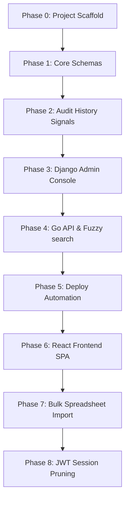

# TMS — Development Roadmap & Spec Ledger

This document serves as the main engineering ledger, data schema reference, deployment specifications, and chronological changelog for TMS.

---

## 📖 Table of Contents
1. [Developer Onboarding & Usage Instructions](#1-developer-onboarding--usage-instructions)
2. [Platform Tech Stack](#2-platform-tech-stack)
3. [Data Models & Schema Hierarchy](#3-data-models--schema-hierarchy)
4. [Role-Based Access Control Matrix](#4-role-based-access-control-matrix)
5. [Die Specifications & Fields](#5-die-specifications--fields)
6. [Core Engineering & Business Rules](#6-core-engineering--business-rules)
7. [Phased Development Roadmap](#7-phased-development-roadmap)
8. [Chronological Changelog](#8-chronological-changelog)

---

## 1. Developer Onboarding & Usage Instructions

> [!IMPORTANT]
> **Guidelines for Developers and AI Coding Agents**:
> 1. Read this entire ledger before modifying any backend files, database schemas, or frontend views.
> 2. Build or refactor in strict phase order as defined in the roadmap timeline.
> 3. Execute quality assurance tests after completing each phase. All unit and E2E specs must pass before moving forward.
> 4. If a check or test fails, debug and resolve it immediately. Do not bypass errors.
> 5. After successful implementation, document the updates under the [Chronological Changelog](#8-chronological-changelog) section.

---

## 2. Platform Tech Stack

| Layer | Component | Description / Details |
| :--- | :--- | :--- |
| **Backend API** | Django 4.2 / REST Framework | Relational CRUD operations, custom permissions, admin integration, and JWT authentication |
| **Search API** | Go (Golang) Microservice | Direct PostgreSQL indexing + Redis caching for high-speed read queries |
| **Databases** | PostgreSQL 18 | Primary relational storage, transactions, auditing |
| **Search Engine**| Meilisearch v1.7 | Fuzzy text search matching (ids, locations, casings) |
| **Frontend** | React 18 + Vite | Single Page Application served via Nginx in production |
| **Reverse Proxy**| Traefik v3 | Local network routing, auto-routing rules, port bindings, and HTTPS via mkcert certificates |
| **TLS Certificates** | mkcert (LAN) | Machine-specific TLS certs for HTTPS LAN access, auto-generated via setup scripts |

---

## 3. Data Models & Schema Hierarchy

TMS organizes data assets in a cascading hierarchical relationship:

---

## 4. Role-Based Access Control Matrix

| System Role | Permissions & Permitted Actions | Interface Restrictions |
| :--- | :--- | :--- |
| **Unauthenticated** | Redirected to `/login`. Safe and mutating API routes require authentication (return HTTP 401). | Full lockout. Cannot browse inventory or access tool features without credentials. |
| **Regular** | Read-only browsing of inventory, dashboard telemetry, and machines. | Read-Only. Mutation forms, die creation, and administrative tabs are disabled. |
| **Operator** | Read-only search, metrics, inventory browsing, machine die reassignments, and recount audits. | Production adjustments only. Locked out of die creation, machine edits, user administration, and backups. |
| **Admin** | Register new dies, edit location/status/remarks, trigger bulk spreadsheet imports, CRUD on Sets & Machines. | Full asset management. Locked out of user administration, theme toggles, and database backup restoration. |
| **Root** | Create/deactivate user accounts, assign roles, toggle tool permissions, manage backups, restore system states, switch system visual themes. | Full administrative access. Single superuser account created via shell seeder. |

### Granular Tool Permissions
Access to specialized engineering tools (`wire-drawing-calculator`, `die-series-generator`) and sub-features (`3d-model`, `theory-docs`) is independently controlled via `User.is_authorized_for_tools` and `User.authorized_tools` string arrays, synchronized in real time without requiring session re-login.

---

## 5. Die Specifications & Fields

Dies are modeled under a unified base model (`Die`) with type-specific attributes:

### Common Fields (All Dies)
*   `die_id` (String, unique, alphanumeric)
*   `casing` (String, dimensions envelope, e.g. `25x10`)
*   `status` (Enum: `AVAILABLE`, `RUNNING`, `CLEANING`, `POLISHING`, `DAMAGED`, `SCRAPPED`, `MISSING`, `MAINTENANCE`)
*   `current_machine` (Foreign Key → Machine, active production machine assignment, nullable)
*   `current_set` (Foreign Key → Set, drafting sequence set allocation, nullable)
*   `remarks` (Text, notes or maintenance reports)

### Round Die Attributes
*   `punched_size` (Decimal, 3 decimal places, mm format)
*   `current_size` (Decimal, 3 decimal places, mm format)

### Flat Die Attributes
*   `punched_width` & `current_width` (Decimal, 3 decimal places, mm format)
*   `punched_thickness` & `current_thickness` (Decimal, 3 decimal places, mm format)
*   `radius` (Decimal, 3 decimal places, corner fillet mm format)

---

## 6. Core Engineering & Business Rules

1.  **Immutable History Logging**: The `DieHistory` model must **only** be written to by PostgreSQL database triggers or Django `pre_save` signals. Developers must never instantiate history logs manually.
2.  **Double-Buffered Search**:
    *   Fuzzy text queries match indices inside Meilisearch.
    *   Decimal ranges and dimensional checks query PostgreSQL directly.
3.  **Idempotent Imports**: Bulk imports update existing dies on matching `die_id`, otherwise create new entries. Rows with invalid columns or dimension formats are skipped, generating row-by-row validation error reports.
4.  **No Merged Cells in Export**: Excel exports using `openpyxl` must use a flat grid layout: single header row followed by clean data rows (no merged cells or styling lines).

---

## 7. Phased Development Roadmap

Follow this phased pipeline when setting up the platform:

---

## 8. Chronological Changelog

### 2026-11-07 · release: Tool Management System (TMS) v1.1.0
- **De-Rackification**: Removed physical warehouse rack and shelf tracking from database models, API endpoints, and frontend user interfaces, refocusing asset management directly on shopfloor machines and tool sets.
- **UI Modernization & Contact Integration**: Integrated dedicated developer contact modal with 1-click clipboard copy, isolated architecture specifications modal, and symmetrical contrast enhancements across Dark Terminal and Precision Light themes.
- **RBAC & Concurrency Hardening**: Added optimistic lock version token authorization for Operator relocation actions.
- **Dependency & CI Parity**: Declared `celery[redis]` transport extras and added Meilisearch service container healthcheck to CI workflows.

### 2026-11-01 · feat: initial commit - Tool Management System (TMS) v1.0.0
- **Core Architecture**: Dual-engine write path (Django 4.2 REST API) and read path (Go 1.22 search proxy & SSE broadcast) with PostgreSQL 18, Redis 7, and Meilisearch v1.7.
- **Die Inventory Management**: Full physical grid tracking (racks, shelves, slots), Round and Flat die support, machine allocations, and physical recount audits.
- **Wire Drawing Workbench**: 3-mode ISO/DIN vector TDS reporting engine, interactive in-place reverse solvers, 4-pass-per-row schematic pipeline, 3D WebGL bore visualizer, and Rust/Wasm FEA stress solver.
- **Security & RBAC**: Role-based access control (ROOT, ADMIN, OPERATOR, VIEWER), single-use recovery backup codes MFA, session eviction on role modifications, and non-root process execution (USER tmsuser, UID 1001).
- **Design System & Typography**: Triple-theme system (Dark Terminal, Classic Slate, Precision Light), 100% self-hosted WOFF2 fonts, and zero tracking.
